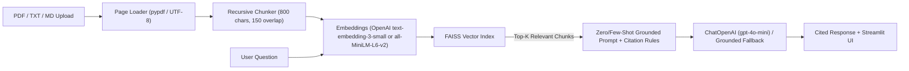

# DocuMind — RAG-Based Document Intelligence Assistant

DocuMind is a Retrieval-Augmented Generation (RAG) pipeline built with **LangChain**, **FAISS**, **OpenAI API** (with automatic local `sentence-transformers` semantic fallback), and **Streamlit**. It ingests multi-page PDFs and text/Markdown files, indexes overlapping chunks in FAISS, answers questions with inline page citations, and summarizes 50+ page documents via batched map-reduce.

## Architecture



## Key Features

- **Document Ingestion & Chunking (`src/documind/ingest.py`):** Extracts text page-by-page from PDFs and splits into overlapping chunks tagged with deterministic `chunk_id` (`<filename>:p<page>:c<idx>`).
- **FAISS Similarity Search (`src/documind/vectorstore.py`):** Indexes embeddings in FAISS alongside a lexical BM25 / exact-keyword baseline for controlled retrieval benchmarks.
- **Grounded Prompt Engineering (`src/documind/prompts.py`):** Zero-shot and few-shot `ChatPromptTemplate`s enforcing `[Source: <filename>, p.<page>]` citations and explicit abstention when context is missing.
- **50+ Page Document Summarization (`src/documind/rag.py`):** Batched map-reduce summarization producing section takeaways and an executive summary.
- **Interactive Streamlit App (`src/documind/app.py`):** Upload custom PDFs or load the bundled 56-page sample handbook ([nova_cloud_handbook_56p.pdf](data/samples/nova_cloud_handbook_56p.pdf)), switch prompt modes, inspect retrieved excerpts, and review benchmark metrics.

## Evaluation Summary

Measured on the 56-page **NovaCloud Engineering & Operations Handbook** (`111` chunks, `28` paraphrased domain questions across all 14 sections, `top_k=4`, local `sentence-transformers/all-MiniLM-L6-v2` embeddings; full details in [eval/results.md](eval/results.md)):

| Retriever | Recall@4 | MRR@4 | Irrelevant-Context Rate |
| :--- | :---: | :---: | :---: |
| Naive Exact-Keyword Baseline | 75.0% | 0.750 | 25.0% |
| BM25 Lexical Baseline | 89.3% | 0.893 | 10.7% |
| **FAISS Semantic RAG** | **100.0%** | **0.955** | **14.3%** |

- **+33.3% relative Recall@4 improvement** over the naive exact-keyword baseline.
- **42.8% reduction in irrelevant-context rate** vs. naive exact-keyword search.
- Out-of-scope guardrail test cleanly returns: `"I cannot find enough information in the provided documents to answer this question."`

## Quickstart

```bash
# 1. Install dependencies (Python 3.12 via uv)
uv sync --all-groups

# 2. Optional: configure OpenAI credentials (runs in local semantic mode if omitted)
cp .env.example .env
# Edit .env and set OPENAI_API_KEY=sk-...

# 3. Run unit & pipeline tests
uv run pytest -v

# 4. Run the reproducible 56-page RAG evaluation benchmark
uv run python eval/evaluate_rag.py

# 5. Launch the interactive Streamlit app
uv run streamlit run src/documind/app.py
```

## Project Structure

```text
documind/
├── data/samples/nova_cloud_handbook_56p.pdf   # 56-page synthetic technical handbook
├── eval/
│   ├── evaluate_rag.py                        # FAISS vs. Keyword/BM25 eval harness
│   ├── qa_dataset.json                        # 28 paraphrased ground-truth queries
│   ├── results.json
│   └── results.md
├── src/documind/
│   ├── app.py                                 # Streamlit UI
│   ├── config.py                              # Env & provider resolution
│   ├── ingest.py                              # PDF/text loader & chunker
│   ├── prompts.py                             # Zero-shot, few-shot & map-reduce prompts
│   ├── rag.py                                 # Core RAG & summarization pipeline
│   ├── sample_data.py                         # 56-page PDF generator
│   └── vectorstore.py                         # FAISS & lexical baseline retrievers
└── tests/
    ├── test_ingest.py
    └── test_rag.py
```
